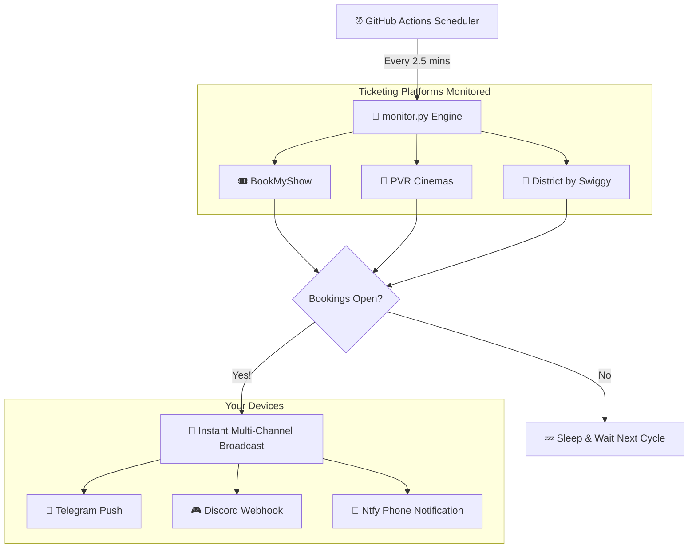

<div align="center">

# 🎬 MovieAlerts

### Automated, High-Speed Movie Ticket Alert System for BookMyShow, PVR & District

[](https://github.com/Shanr17/MovieAlerts/actions)


**Never miss first-day-first-show tickets again.**  
MovieAlerts runs 24/7 in the cloud with zero servers to manage, polling ticketing engines every 2.5 minutes and delivering instant push notifications straight to your phone.

[Quick Start](#-quick-start-in-3-steps) • [Supported Platforms](#-supported-platforms) • [Alert Channels](#-instant-alert-channels) • [Dashboard](#-web-dashboard) • [Configuration](#-configuration--secrets)

</div>

---

## ⚡ Why MovieAlerts?

Blockbuster movie bookings often sell out in minutes without any prior notice. Manual refreshing is frustrating and unreliable. 

**MovieAlerts solves this by:**
- ⏱️ **Checking every 2.5 minutes (150 seconds)** round-the-clock.
- ☁️ **Running 100% serverless** on GitHub Actions with **unlimited free runtime**.
- 🛡️ **Zero credit card or hosting fees required**.
- 📲 **Pushing instant alerts with direct 1-click booking links** via Telegram, Discord, and Ntfy.sh.
- 🎛️ **Featuring a built-in Web Dashboard** deployed directly on GitHub Pages.

---

## 🎯 Architecture & How It Works



---

## 🎟️ Supported Platforms

| Platform | Coverage | Status | Method |
|---|---|:---:|---|
| **BookMyShow** | All major cities & local theaters across India | ✅ Active | Direct Explore & Showtimes API |
| **PVR Cinemas** | PVR Multiplexes & INOX screens nationwide | ✅ Active | Real-time Cinema Schedule Engine |
| **District (Swiggy)** | Major metro cinema chains & special premieres | ✅ Active | Fast Catalog & Venue Resolver |

---

## 🔔 Instant Alert Channels

Choose one or enable all three simultaneously:

| Channel | Setup Difficulty | Account Needed? | Features |
|---|:---:|:---:|---|
| **📡 Ntfy.sh** | **Super Easy (1 min)** | ❌ No | Install app, subscribe to topic, urgent push priority with 1-tap booking button |
| **📱 Telegram Bot** | **Easy (2 mins)** | ✅ Yes | Formatted markdown alert, direct booking URL, detects show timings |
| **🎮 Discord Webhook** | **Easy (2 mins)** | ✅ Yes | Rich colored embeds with showtime schedules and instant link |

---

## 🌐 Web Dashboard

MovieAlerts includes a local and hosted web dashboard built right into the repository.

* **Live URL:** `https://Shanr17.github.io/MovieAlerts/`
* **Features:**
  * Visual selector for major Indian cities (Mumbai, NCR, Bangalore, Chennai, Hyderabad, etc.).
  * Fast input for target movie & theater.
  * Checkbox toggles for platforms and alert channels.
  * One-click trigger to initiate a check on-demand.
  * Stored credentials remain strictly within your browser's private `localStorage`.

---

## 🚀 Quick Start in 3 Steps

### 1. Add Secrets to Your Repository
Navigate to your repository on GitHub:
👉 **Settings** → **Secrets and variables** → **Actions** → **New repository secret**

Add these essentials:
```env
MOVIE_NAME      = Pushpa 2
THEATER_NAME    = PVR Phoenix MarketCity
CITY            = chennai
```

### 2. Connect Your Alert Method
Add the secrets for whichever alert service you prefer:

#### Option A: Ntfy (Fastest — No account or tokens needed!)
1. Install **ntfy** on Android or iOS.
2. Subscribe to any private topic (e.g. `shan-movie-tickets-2026`).
3. Add these GitHub secrets:
   * `NTFY_TOPIC`: `shan-movie-tickets-2026`
   * `NTFY_ENABLED`: `true`

#### Option B: Telegram
1. Message `@BotFather` on Telegram, create a bot, and copy the **Bot Token**.
2. Message `@userinfobot` to get your numerical **Chat ID**.
3. Add these GitHub secrets:
   * `TELEGRAM_BOT_TOKEN`: `your-bot-token`
   * `TELEGRAM_CHAT_ID`: `your-chat-id`
   * `TELEGRAM_ENABLED`: `true`

#### Option C: Discord
1. In Discord server channel settings → **Integrations** → **Webhooks** → **New Webhook**.
2. Copy the Webhook URL and add secret:
   * `DISCORD_WEBHOOK_URL`: `https://discord.com/api/webhooks/...`
   * `DISCORD_ENABLED`: `true`

### 3. Verify It Running
1. Go to the **Actions** tab on your repository.
2. Select **Movie Ticket Monitor**.
3. Click **Run workflow** to test it right now! It will also automatically trigger every 2.5 minutes.

---

## 🔐 Configuration & Secrets Reference

All parameters can be configured via GitHub Secrets (for cloud automation) or `config.json` (for local runs):

| Secret / Config Key | Description | Example |
|---|---|---|
| `MOVIE_NAME` | Name of the movie to detect | `Avatar 3` |
| `THEATER_NAME` | Name of the theater / cinema hall | `SPI Palazzo` |
| `CITY` | City name (case-insensitive) | `chennai`, `bangalore`, `mumbai` |
| `CITY_CODE` | Optional BMS city code override | `CHEN`, `BANG`, `MUMBAI` |
| `CHECK_BMS` | Check BookMyShow (`true` / `false`) | `true` |
| `CHECK_PVR` | Check PVR Cinemas (`true` / `false`) | `true` |
| `CHECK_DISTRICT` | Check District (`true` / `false`) | `true` |
| `CHECK_NEXT_DAYS` | How many days ahead to scan (default 7) | `7` |

---

## 💻 Running Locally on Windows / Mac / Linux

If you prefer to run the monitor on your own computer or phone:

```bash
# Clone the repository
git clone https://github.com/Shanr17/MovieAlerts.git
cd MovieAlerts

# Install dependencies
pip install -r requirements.txt

# Run continuous 2.5-minute loop
python monitor.py --loop --interval 150
```

On Windows, you can also simply double-click **`run_local_2min.bat`** to start monitoring immediately.

---

## 🛡️ Privacy & Security

- **Repository is Public, but Secrets are Private:** Sensitive keys (Bot tokens, webhook URLs) are stored in encrypted GitHub Repository Secrets. They are never exposed in logs or visible to repository visitors.
- **Smart De-duplication:** State is saved in `state.json` to ensure you receive a notification once when tickets drop—without repetitive spam.

---

<div align="center">

Made for movie lovers who value first-day-first-show seats 🍿

⭐ **Found this useful? Star this repo to show support!**

</div>
